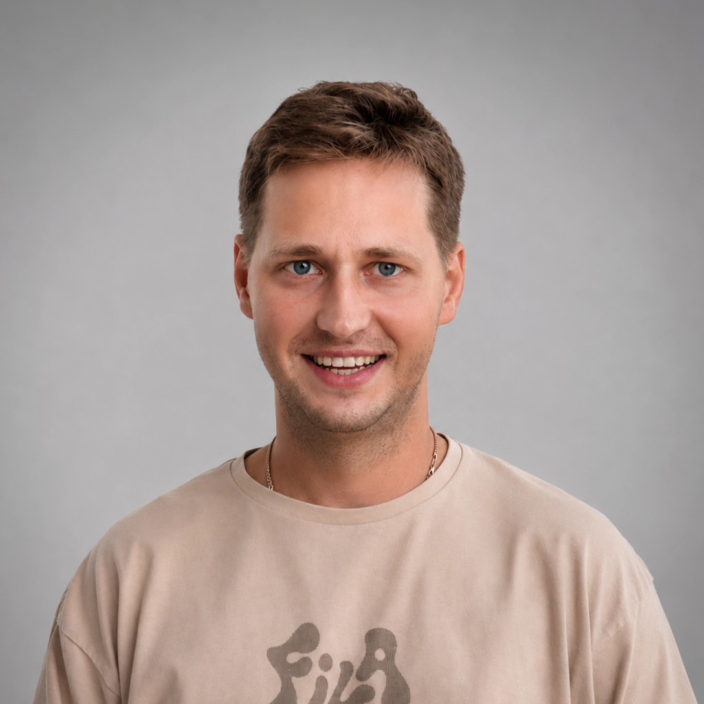

# Дмитрий Морозов

### Python backend-разработчик · Django / DRF

**Python · Django REST Framework · PostgreSQL · Docker · Linux · REST API**

Разрабатываю веб-приложения и REST API на Python, Django/DRF и PostgreSQL: работа с данными, авторизация, интеграции и автотесты. Мои проекты — «Мир улыбок», My Cloud и PilotSpace. С января 2022 года занимаюсь коммерческой веб-разработкой на PHP и JavaScript в Студии Кудинова. По образованию — инженер-программист.

Оренбург · Удалённо, гибрид или офис · Готов к переезду · Полная занятость

[Telegram: @dem2014](https://t.me/dem2014) · [Email: dem.morozov@gmail.com](mailto:dem.morozov@gmail.com) · [GitHub](https://github.com/dm-morozov)

[Резюме PDF — скачать или открыть](dmitry_morozov_backend_resume.pdf)

## Основной стек

- **Backend:** Python, Django, Django REST Framework, Flask, REST API, HTTP.
- **Данные:** PostgreSQL, SQL, Django ORM, SQLAlchemy, SQLite.
- **Тестирование и качество:** pytest, фикстуры и тесты Django REST API, Django Test Framework.
- **Окружение и доставка:** Git, Docker / Docker Compose, Linux (Ubuntu), Nginx, Gunicorn, GitHub Actions (CI/CD).
- **Интеграции:** Telegram Bot API, VK API, Яндекс Диск API, Google Drive API.
- **Frontend и сопутствующий стек:** JavaScript, TypeScript, React, HTML / CSS, PHP, WordPress, 1С-Битрикс.

## Ключевые продукты и сервисы

Самостоятельные проекты: от схемы данных и API до интерфейса, тестов и развёртывания.

### [«Мир улыбок» — платформа агентства праздников](https://github.com/dm-morozov/mu56.ru)

**Django / DRF · PostgreSQL · Next.js · Telegram API · Docker**

- Спроектировал БД в PostgreSQL и REST API каталога с динамическим расчётом стоимости заказов.
- Реализовал идемпотентный API заявок: защита от дублирования заказов и сообщений при сбоях сети.
- Организовал очередь Telegram-уведомлений: хранение статусов доставки, повторные попытки и обработка ошибок.
- Покрыл автотестами валидацию входных данных, расчёты, идемпотентность и обработку ошибок.
- Настроил Docker Compose, отдельные dev/prod среды и CI/CD в GitHub Actions; проверяю приложение после развёртывания.

[Демо](https://mu56.ru/)

### [My Cloud — персональное файловое хранилище](https://github.com/dm-morozov/my-cloud)

**Python · Django / DRF · PostgreSQL · React · TypeScript · Docker**

[Демо](https://mycloud.mu56.ru/)

- Разработал REST API: регистрация, квоты, потоковая загрузка/скачивание, генерация публичных ссылок.
- Настроил сессионную аутентификацию, CSRF-защиту, роли user/admin и автотесты прав доступа и API.
- Развернул полный стек в Docker Compose на Ubuntu VDS (PostgreSQL, Gunicorn, Nginx, SSL), CI/CD в GitHub Actions.
- Реализовал адаптивный SPA-клиент на React + TypeScript с поиском файлов и модульной архитектурой API.

### [PilotSpace — сервис подготовки пилотов и авиаспециалистов](https://github.com/dm-morozov/pilotspace.ru)

**Python · Обработка данных / ETL · JSON · Веб-сервис**

- Разработал Python ETL-пайплайн: парсинг, валидация и нормализация экзаменационных вопросов из PDF в JSON.
- Реализовал алгоритмы выборки вопросов по категориям, интерактивное тестирование и разбор ошибок.
- Создал веб-интерфейс тренировки с сохранением прогресса и возможностью автономной работы.

[Демо](https://pilotspace.ru/)

## Коммерческий опыт разработки

### Студия Кудинова / akudinov.top · Веб-программист

**Январь 2022 — настоящее время**

- Поддерживаю и дорабатываю коммерческие сайты: PHP, JavaScript, CSS, SQL, WordPress и 1С-Битрикс.
- Настраиваю локальные среды в Docker и автоматизированное развёртывание через GitHub Actions.
- Работаю с отдельными средами разработки и production, резервными копиями и сценариями отката; проверяю изменения после выкладки.
- Разрабатываю и дорабатываю функциональность сайтов на PHP и JavaScript: пагинацию, фильтрацию, работу с данными и интеграции с внешними REST API.
- Верстаю адаптивные страницы по макетам Figma, оптимизирую скорость работы сайтов и дорабатываю legacy-код в команде разработчиков.

## Дополнительные проекты

| Проект | Задача и реализация |
| :--- | :--- |
| [Django / DRF — API и работа с данными](https://github.com/dm-morozov/Netology_25_Django_homework_all) | Набор решений на Django и DRF: REST API, Django ORM, права доступа и ограничение частоты запросов. |
| [Bosa Noga — интернет-магазин](https://github.com/dm-morozov/netology_77_react-diploma-project) | React, TypeScript, Redux Toolkit и Redux-Saga: каталог, поиск, фильтры, карточки товаров, корзина и оформление демо-заказа. API развёрнут в Docker на Ubuntu VDS, frontend — на GitHub Pages. [Демо](https://dm-morozov.github.io/netology_77_react-diploma-project/). |
| [User Management Flask](https://github.com/dm-morozov/user-management-flask) | REST API на Flask/SQLite и TypeScript-клиент: CRUD пользователей, валидация данных и обработка повторного email. API развёрнут на Ubuntu VDS через Docker, Gunicorn и Nginx; SQLite — в постоянном томе. [Демо](https://dm-morozov.github.io/user-management-flask/). |
| [Retro Game](https://github.com/dm-morozov/Netology_64_diploma_assignment_course_advanced_javascript_retro_game) | Игра на TypeScript с тестами на Jest: игровая логика и проверка её работы. [Демо](https://dm-morozov.github.io/Netology_64_diploma_assignment_course_advanced_javascript_retro_game/). |
| [Автоматизация бэкапов в облачные хранилища](https://github.com/dm-morozov/Netology_Course_work__Backup_from_VK_to_Ya_Disk_and_Google_drive) | Сервис резервного копирования: параллельный сбор медиа через VK API, загрузка в Яндекс Диск и Google Drive API, логирование метаданных в JSON. |
| [Telegram-бот для изучения английского](https://github.com/dm-morozov/Netology_14_Telegram_Bot) | Хранение словаря в PostgreSQL через SQLAlchemy, упражнения на перевод, добавление и удаление слов, обработка команд. |

Дополнительно: [автотесты Django REST API на pytest](https://github.com/dm-morozov/Netology_31_Testing_django_applications_using_pytest) — фикстуры, проверка ответов API; [VKinder](https://github.com/dm-morozov/Netology_21_VKinder_Team) — в командном проекте спроектировал схему PostgreSQL, создал ORM-модели и реализовал обработку и фильтрацию данных VK API.

## AI-инструменты

Использую **Codex**, Claude, ChatGPT и Antigravity для работы с кодом, отладки, тестов и настройки окружения. Ставлю задачи, проверяю изменения и работу приложения перед публикацией.

## Образование

- **Оренбургский государственный университет · 2008–2013**
  Факультет информационных технологий, специальность «Информационные системы и технологии», квалификация **«Инженер-программист»**. Средний балл диплома — **4,7**.
- **Нетология · 2024–2026**
  Профессиональная переподготовка: **«Fullstack-разработчик на Python»**. [Диплом](certificates_course_netology/diploma_fullstack_python.pdf) · [Сертификаты](certificates_course_netology/).

**Английский:** A2, читаю техническую документацию со словарём.
